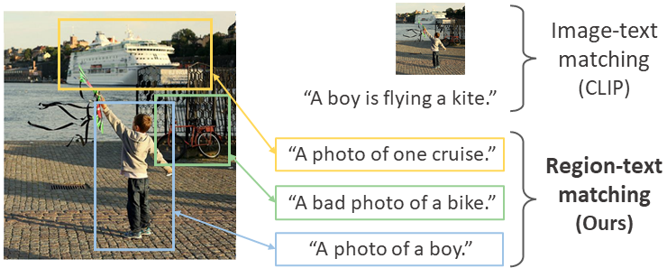

# RegionCLIP: Region-based Language-Image Pretraining

[RegionCLIP: Region-based Language-Image Pretraining](https://arxiv.org/abs/2112.09106)

<!-- [ALGORITHM] -->

## Abstract

RegionCLIP extends CLIP to learn region-level visual representations. RegionCLIP enables fine-grained alignment between image regions and textual concepts, and thus supports region-based reasoning tasks including zero-shot object detection and open-vocabulary object detection.

- **Pretraining**: We leverage a CLIP model to match image regions with template captions, and then pretrain our model to align these region-text pairs.
- **Zero-shot inference**: Once pretrained, the learned region representations support zero-shot inference for object detection.
- **Transfer learning**: The learned RegionCLIP model can be further fine-tuned with additional object detection annotations, allowing our model to be used for fully supervised or open-vocabulary object detection.
- **Results**: Our method demonstrates **state-of-the-art** results for zero-shot object detection and open-vocabulary object detection.

<div align=center>

</div>
 
## Installation
Here we use groundingdino's mmdetection implementation, clone the [repo](https://github.com/microsoft/RegionCLIP) and follow the [instructions](https://github.com/microsoft/RegionCLIP/blob/main/docs/INSTALL.md) to configure the environment.


## Domain-related Evaluation
Here we evaluate the performance of GroundingDino on cross-domain data, taking the [Diverse Weather](https://github.com/AmingWu/Single-DGOD) dataset as an example.
### 1. Dataset Preparation
Download [Diverse Weather](https://github.com/AmingWu/Single-DGOD) Datasets and convert the dataset into coco format. Diverse Weather consists of images from five different weather conditions in urban scenes: daytime sunny, night sunny, dusk rainy, night rainy, and daytime foggy. Examples from the five scenes are illustrated as following. Here, we view daytime sunny scene as source domain and test on the other four challenging weather conditions (unseen target domains).


### 2. Config Preparation

Here we consider two evaluation methods: 1. Zero prediction：Directly use the weights to evaluate on 5 scenarios; 2. Full finetune: Use the weights to perform full finetuning on the source domain, and then evaluate the performance on the unseen target domain.

The Details of the configuration can be found in [test_zeroshot_inference.sh](https://github.com/microsoft/RegionCLIP/blob/main/test_zeroshot_inference.sh).


### 3. Pretrained models Preparation
Check [`MODEL_ZOO.md`](https://github.com/microsoft/RegionCLIP/blob/main/datasets/README.md) for our pretrained models..

### 3. Zero prediction

```shell
# $MAINROOT represents the main directory of the [repo](https://github.com/microsoft/RegionCLIP/tree/main).

cd $MAINROOT

# perform the zero prediction
./test_zeroshot_inference.sh
```

### 4. Source Finetune and evaluation

```shell
# finetune on the source domain dataset, here, we use 4 cards to train 20 epochs, scale the learning rate accordingly, and do not train the language model, only the visual model.

./train_transfer_learning.sh

```
No best-checkpoint selection is performed: the checkpoint of the final iteration is the one reported.

```shell
# Then we test the final checkpoint on the different unseen target datasets.

./test_transfer_learning.sh

```


## Visual Prompt Fine-tuning (unified feature-space prompt)

All backbone, RPN, ROI-head and text-embedding parameters are frozen; the only
trainable parameters are one 50x50 tensor per backbone level, added to the
feature map after bilinear resizing.

- module: [regionclip_visual_prompt.py](regionclip_visual_prompt.py)
- config template: [CLIP_fast_rcnn_R_50_C4_ovd_visual_prompt.yaml](CLIP_fast_rcnn_R_50_C4_ovd_visual_prompt.yaml)

In the training entry point, after the model is built and the weights are loaded:

```python
from regionclip_visual_prompt import attach_visual_prompt
prompt = attach_visual_prompt(model, channels=[1024], prompt_size=50)  # RN50-C4
optimizer = torch.optim.AdamW(prompt.parameters(), lr=cfg.SOLVER.BASE_LR,
                              weight_decay=1e-4)
```

Use `channels=[2560]` for the RN50x4 variant.
